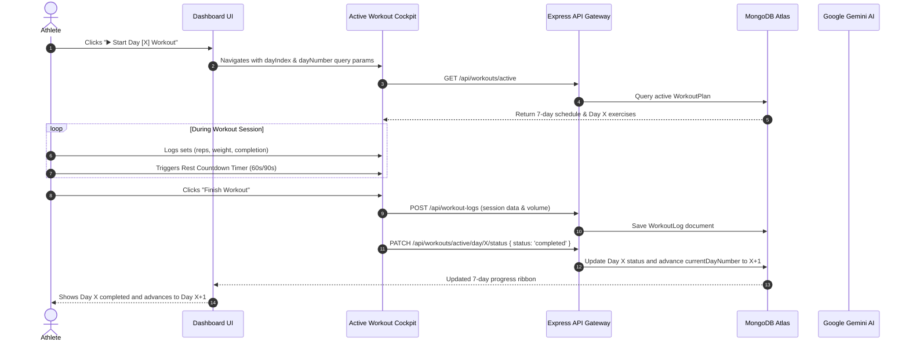
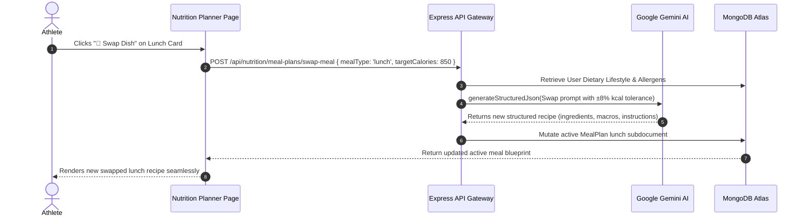
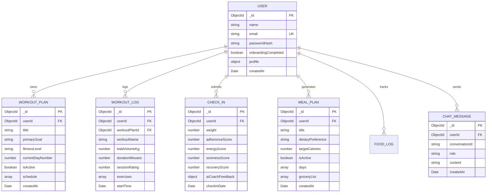

# FitWise AI — Comprehensive Project Specification & Technical Report

---

## 1. Executive Summary & Project Overview

### 1.1 Project Title & Domain
- **Project Title**: FitWise AI — Intelligent Personal Fitness & Nutrition Coaching Platform
- **Domain**: HealthTech, Artificial Intelligence, Exercise Physiology, Sports Nutrition, Web Application Engineering
- **Target Audience**: Strength athletes, fitness enthusiasts, beginners seeking guided progression, personal trainers, and individuals seeking science-based nutrition and structured workout programming.

### 1.2 Problem Statement
Traditional fitness and nutrition applications suffer from critical limitations:
1. **Rigid, Static Templates**: Most applications offer generic, one-size-fits-all workout routines that do not adapt to an athlete's available equipment, recovery state, or changing strength levels.
2. **Redundant & Tedious User Flows**: Users are repeatedly prompted for the same fitness level, equipment, and duration information every time they attempt to generate a routine.
3. **Disjointed Ecosystems**: Workout tracking, meal planning, fatigue monitoring, and analytics are often split across different apps without shared telemetry.
4. **Superficial Nutrition Advice**: Meal planners often generate unrealistic 7-day grocery lists, ignore dietary lifestyles (e.g., Vegetarian, Vegan, Pescatarian), or fail to offer simple 1-click meal swaps when a user dislikes a specific dish.
5. **Generic AI Chatbots**: Generic fitness chatbots lack access to the athlete's live telemetry (e.g., what day of their workout plan they are on, recent volume lifted, recovery score, or caloric targets), leading to vague, generic advice.

### 1.3 The FitWise AI Solution
**FitWise AI** is an end-to-end, full-stack intelligent fitness and nutrition platform powered by **Google Gemini Cloud AI** and **MongoDB Atlas**. It unifies exercise programming, live set-by-set execution, scientific meal planning, fatigue-driven adaptation, and conversational coaching into a single, cohesive, high-performance web platform.

---

## 2. Complete Technology Stack

| Layer / Domain | Technology | Specification / Version | Role & Functionality |
|---|---|---|---|
| **Frontend Framework** | React.js | v18.3.1 | Component-based Single Page Application (SPA) |
| **Build Tool & Bundler** | Vite | v6.4.3 | Instant Hot Module Replacement (HMR) and optimized rollup production bundles |
| **Routing** | React Router DOM | v6.28.0 | Client-side routing with protected authenticated routes |
| **Styling & Design System** | TailwindCSS | v3.4.17 | Custom Red & Dark Black design system with glassmorphic cards and silver borders |
| **Iconography** | Lucide React | v0.468.0 | Vector icons for workout, nutrition, navigation, and telemetry HUDs |
| **Backend Runtime** | Node.js | v22.9.0 (v18+ compatible) | Asynchronous, event-driven server runtime |
| **Backend Framework** | Express.js | v4.21.2 | High-performance RESTful API Gateway |
| **Database & ODM** | MongoDB Atlas & Mongoose | Mongoose v8.8.4 | Cloud NoSQL database with connection resilience & local fallback (`localhost:27017`) |
| **AI / LLM Engine** | Google Gemini Cloud AI | `@google/generative-ai` v0.21.0 | `gemini-3.1-flash-lite`, `gemini-3.5-flash-lite`, `gemini-flash-latest` (< 1s inference) |
| **Offline AI Fallback** | Sports-Science Rules Engine | Custom ES6 Module | 100% offline fallback ensuring zero downtime if cloud AI is unreachable |
| **Authentication & Security** | JWT & Bcrypt.js | `jsonwebtoken` v9.0.2, `bcryptjs` v2.4.3 | Stateless JWT in `HttpOnly` SameSite cookies + Bearer token fallback |
| **Schema Validation** | Zod | v3.23.8 | Type-safe runtime schema validation for API inputs and AI structured JSON outputs |
| **Security Headers** | Helmet | v8.0.0 | HTTP security headers (CSP, XSS protection, HSTS, frameguard) |
| **Rate Limiting** | Express Rate Limit | v7.4.1 | 100 auth req / 15m, 1000 general api req / 15m |
| **Compression** | Compression | v1.7.5 | Gzip/Brotli payload compression for fast network throughput |

---

## 3. High-Level System Architecture

```mermaid
graph TD
    subgraph Client Layer [React 18 + Vite SPA]
        UI[Athlete Dashboard & Cockpits]
        Router[React Router DOM]
        AuthContext[Auth & Session Provider]
        UI --> Router
        Router --> AuthContext
    end

    subgraph API Gateway [Express.js Server :5000]
        Security[Helmet + Rate Limiter + CORS]
        AuthMiddleware[JWT Cookie / Bearer Verification]
        Validator[Zod Schema Validation Middleware]
        Router --> Security --> AuthMiddleware --> Validator
    end

    subgraph Service Layer [Modular Backend Business Logic]
        AuthService[Auth & Security Service]
        UserService[Onboarding & Profile Service]
        WorkoutService[Workout Engine & 7-Day Progression]
        LogService[Workout Execution & Session Logger]
        CheckInService[Weekly Check-In & Adaptive Overload Loop]
        NutritionService[TDEE & Daily Meal Blueprint Engine]
        ChatService[Coach Pulse Conversational Engine]
        AnalyticsService[1RM Math & PR Analytics Engine]
    end

    subgraph Cloud Data & AI Layer
        Gemini[Google Gemini AI Cloud Engine]
        RulesFallback[Sports-Science Expert Rules Engine]
        MongoAtlas[(MongoDB Atlas Cloud Database)]
        LocalMongo[(Local MongoDB Fallback)]
    end

    Validator --> AuthService & UserService & WorkoutService & LogService & CheckInService & NutritionService & ChatService & AnalyticsService
    WorkoutService & CheckInService & NutritionService & ChatService & AnalyticsService <--> Gemini
    WorkoutService & CheckInService & NutritionService & ChatService & AnalyticsService -.-> RulesFallback
    Service Layer <--> MongoAtlas
    MongoAtlas -.->|Connection Resilience| LocalMongo
```

---

## 4. Detailed Module Breakdown & Core Features

### 4.1 Module 1: Authentication & Identity Management
- **Stateless JWT Architecture**: Issues JSON Web Tokens signed with HMAC-SHA256 containing user ID and email.
- **Dual Transport Security**: Stored primarily in `HttpOnly`, `SameSite=Lax`, `Secure` (in production) cookies to prevent Cross-Site Scripting (XSS) token theft, with optional `Authorization: Bearer <token>` header support.
- **Password Protection**: Uses `bcryptjs` with salt round factor of 10.
- **Protected Routing**: React client wraps sensitive views (`/dashboard`, `/workouts`, `/active-workout`, `/nutrition`, `/chat`, `/analytics`, `/profile`) in `<ProtectedRoute />` components.

### 4.2 Module 2: Athlete Onboarding & Biometrics Engine
- **6-Step Assessment Wizard**:
  1. **Identity & Demographics**: Name, Age, Gender.
  2. **Body Metrics**: Height (cm), Weight (kg).
  3. **Training Parameters**: Primary Goal (*Muscle Gain*, *Fat Loss*, *Strength*, *Endurance*), Fitness Level (*Beginner*, *Intermediate*, *Advanced*), Workout Days per Week (1 to 7), Preferred Session Duration (**30, 45, 60, 75, 90, 120 minutes**).
  4. **Equipment Inventory**: Bodyweight only, Dumbbells, Resistance Bands, Barbell, Bench, Pull-Up Bar, Kettlebells, Cable Machine, Full Gym.
  5. **Nutrition Preferences**: Dietary Lifestyle (*Omnivore*, *Vegetarian*, *Vegan*, *Pescatarian*, *Keto*, *Paleo*), Allergens / Disliked Foods.
  6. **Review & Ingestion**: Saves biometrics and marks `onboardingCompleted: true`.

### 4.3 Module 3: AI 7-Day Workout Generator & Progression Engine
- **Zero Redundant Inputs**: Pulls saved parameters directly from `user.profile`—no repetitive questions.
- **7-Day Progression Structure (Day 1 to Day 7)**:
  - Generates a full 7-day weekly split matching the user's days/week setting.
  - Days are categorized into **Training Days** (with structured compound/isolation movements, target muscles, sets, reps, and RPE) and **Scheduled Active Recovery & Mobility Rest Days**.
- **Interactive Day-by-Day State Machine**:
  - `status: 'pending' | 'completed' | 'skipped'`
  - `currentDayNumber: 1..7` (points to the active day in progression).
  - **"✓ Mark Done / Rest Taken"**: Marks current day completed and advances `currentDayNumber` to the next pending day.
  - **"⏭️ Skip Day"**: Skips current day and advances pointer.
  - **"↺ Reset Day"**: Reverts day status back to pending.
  - **"🔄 Reset Cycle"**: Resets all 7 days back to pending and restarts progression from Day 1.
- **Curated Exercise Repository**: 50+ exercises categorized by muscle group (Chest, Back, Shoulders, Biceps, Triceps, Quads, Hamstrings, Glutes, Calves, Core) with movement cues, equipment filters, and rest intervals.

### 4.4 Module 4: Live Workout Execution Cockpit & Session Logging
- **Live Workout HUD**:
  - Live elapsed workout stopwatch timer.
  - Set-by-set input cards: Previous weight/reps reference, target weight (kg), target reps, and set completion checkboxes.
  - Automated rest countdown timer modal (30s, 60s, 90s, 120s, 180s) with audio/visual notification.
  - Real-time cumulative volume calculator:
    $$\text{Total Volume (kg)} = \sum (\text{weight} \times \text{reps})$$
- **Automatic Progression Advancement**:
  - Upon clicking **"Complete Workout"**, the session is saved to `WorkoutLog` and automatically sends a `PATCH` request to update that day's status on the active workout plan to `completed`.

### 4.5 Module 5: Adaptive Weekly Coaching Loop (Fatigue & Overload)
- **Weekly Check-In Telemetry**:
  - Athletes submit current bodyweight, subjective adherence rating (1-5), systemic energy rating (1-5), and muscle soreness level (1-5).
- **Quantitative Recovery Score (0-100%)**:
  $$\text{Recovery Score} = \left(\frac{\text{Energy}}{5} \times 0.4 + \frac{6 - \text{Soreness}}{5} \times 0.4 + \frac{\text{Adherence}}{5} \times 0.2\right) \times 100$$
- **Automated Routine Mutation**:
  - **Optimal Recovery ($\ge 75\%$)**: Triggers **Progressive Overload** (+2.5kg to compound lifts, +1 rep per set).
  - **Moderate Recovery ($50\text{--}74\%$)**: Prescribes **Maintain & Consolidate** volume.
  - **High Fatigue ($< 50\%$)**: Automatically prescribes an **Active Deload Week** (-30% volume, reduced RPE).

### 4.6 Module 6: Nutrition Assistant & Daily Meal Blueprint
- **Scientific TDEE Engine (Mifflin-St Jeor)**:
  $$\text{BMR}_{\text{male}} = 10 \times \text{weight (kg)} + 6.25 \times \text{height (cm)} - 5 \times \text{age} + 5$$
  $$\text{BMR}_{\text{female}} = 10 \times \text{weight (kg)} + 6.25 \times \text{height (cm)} - 5 \times \text{age} - 161$$
  $$\text{TDEE} = \text{BMR} \times \text{Activity Multiplier} + \text{Goal Caloric Offset}$$
- **1-Day Daily Meal Blueprint**:
  - Chronological 4-meal schedule: **Breakfast $\longrightarrow$ Lunch $\longrightarrow$ Snack $\longrightarrow$ Dinner**.
  - Displays total daily calories, protein (g), carbohydrates (g), and fats (g).
- **Instant 1-Click Dish Swap**:
  - Direct 1-click **"🎲 Swap Dish"** button on each meal card.
  - Invokes AI to generate a brand-new recipe matching the user's dietary lifestyle with $\pm 5\text{--}12\%$ realistic caloric variance.
- **Dietary Lifestyle Compliance**: Strict compliance for **Vegetarian**, **Vegan**, **Pescatarian**, and **Omnivore** lifestyles.
- **Clean Daily Grocery List**: Minimalist, categorized ingredient checklist (Produce, Protein & Dairy, Pantry & Grains, Spices & Oils) for the day's meals.

### 4.7 Module 7: AI Chat Coach — "Coach Pulse"
- **Deep Live Athlete Context Injection**:
  - Every message sent to Coach Pulse dynamically injects:
    - Athlete name, age, weight, height, goal, fitness level, and equipment inventory.
    - Active 7-day routine title and current day in progression (e.g. `Day 2 of 7: Lower Body`).
    - Recent 7-day training volume (number of workouts completed, total kg moved).
    - Latest recovery score and check-in coaching recommendations.
    - Daily calorie, protein, carb, and fat targets.
    - Dietary lifestyle and allergens/dislikes.
- **Domain Specializations**:
  - Exercise substitutions strictly tailored to available equipment.
  - Workout schedule inquiries (*"What is my workout today?"*).
  - Pre/post-workout nutrient timing and hydration strategies.
  - Lifting biomechanics and form cues (Bench Press, Squat, Deadlift, Overhead Press).
  - Fatigue management and plateau busting (Double progression, micro-loading, RPE targets).

### 4.8 Module 8: Analytics, PR Trophies & 1RM Math
- **Interactive SVG Visualizations**:
  - Volume progression bar charts across 7D, 30D, 90D, and All-Time.
  - Bodyweight trend tracking.
  - Recovery readiness historical trends.
- **Personal Records (PRs) & 1RM Calculator**:
  - Scans all logged sessions to extract maximum weight lifted per exercise.
  - Calculates Estimated 1-Rep Max (1RM) using the scientific **Epley Formula**:
    $$\text{1RM} = \text{weight} \times \left(1 + \frac{\text{reps}}{30}\right)$$
- **AI Monthly Performance Reviews**:
  - Generates comprehensive monthly milestone evaluations, progress grades (e.g. A, B+), and recommendations.

---

## 5. End-to-End Data Flows & Sequences

### 5.1 Workout Progression & Logging Flow


### 5.2 1-Click Meal Swap Flow


---

## 6. Database Schemas & Data Architecture



---

## 7. Complete REST API Specifications

| Method | Route | Auth | Payload / Params | Success Code | Description |
|---|---|---|---|---|---|
| `POST` | `/api/auth/register` | Public | `{ name, email, password }` | `201 Created` | Registers user, hashes password, sets `HttpOnly` cookie |
| `POST` | `/api/auth/login` | Public | `{ email, password }` | `200 OK` | Authenticates credentials and sets `HttpOnly` cookie |
| `POST` | `/api/auth/logout` | Public | None | `200 OK` | Clears authentication cookie |
| `GET` | `/api/auth/me` | Private | None | `200 OK` | Returns authenticated user document |
| `POST` | `/api/users/onboarding` | Private | Full 6-step biometric JSON | `200 OK` | Saves profile biometrics and completes onboarding |
| `GET` | `/api/users/profile` | Private | None | `200 OK` | Returns current profile biometrics & equipment |
| `PUT` | `/api/users/profile` | Private | Updated biometrics | `200 OK` | Updates weight, goals, or equipment |
| `POST` | `/api/workouts/generate` | Private | `{ customNotes }` | `201 Created` | Generates 7-day AI workout progression from profile stats |
| `GET` | `/api/workouts/active` | Private | None | `200 OK` | Retrieves currently active 7-day workout plan |
| `PATCH`| `/api/workouts/active/day/:dayNumber/status` | Private | `{ status: 'completed' \| 'skipped' \| 'pending' }` | `200 OK` | Updates day status and auto-advances progression pointer |
| `POST` | `/api/workouts/active/reset-cycle` | Private | None | `200 OK` | Resets all 7 days to pending and restarts cycle from Day 1 |
| `GET` | `/api/workouts/exercises` | Private | `?muscleGroup=&equipment=&search=` | `200 OK` | Queries exercise catalog with filters |
| `POST` | `/api/workout-logs` | Private | Live session sets & metrics | `201 Created` | Logs completed workout session to history |
| `GET` | `/api/workout-logs` | Private | `?limit=10&skip=0` | `200 OK` | Returns historical workout logs |
| `POST` | `/api/check-ins` | Private | `{ weight, adherenceScore, energyScore, sorenessScore }` | `201 Created` | Evaluates recovery score & triggers adaptive overload/deload |
| `GET` | `/api/check-ins/latest` | Private | None | `200 OK` | Retrieves latest check-in and recovery grade |
| `GET` | `/api/nutrition/targets` | Private | None | `200 OK` | Calculates scientific TDEE and macro breakdown |
| `POST` | `/api/nutrition/meal-plans/generate` | Private | `{ customNotes }` | `201 Created` | Generates 1-day daily AI meal blueprint |
| `GET` | `/api/nutrition/meal-plans/active` | Private | None | `200 OK` | Returns active daily meal blueprint & grocery list |
| `POST` | `/api/nutrition/meal-plans/swap-meal` | Private | `{ mealType: 'breakfast' \| 'lunch' \| 'snack' \| 'dinner' }` | `200 OK` | 1-Click swap for individual dish |
| `POST` | `/api/nutrition/food-logs` | Private | `{ foodName, calories, protein, carbs, fats, mealType }` | `201 Created` | Logs custom food item to daily diary |
| `POST` | `/api/chat` | Private | `{ content, conversationId }` | `200 OK` | Sends message to Coach Pulse with deep context injection |
| `GET` | `/api/chat/history` | Private | `?conversationId=default` | `200 OK` | Returns conversation chat history |
| `DELETE`| `/api/chat/history` | Private | `?conversationId=default` | `200 OK` | Clears conversation chat history |
| `GET` | `/api/analytics/dashboard` | Private | `?timeRange=7d \| 30d \| 90d \| all` | `200 OK` | Returns volume charts, KPIs, and weight curves |
| `GET` | `/api/analytics/personal-records` | Private | None | `200 OK` | Extracts all-time PR trophies and 1RM calculations |
| `GET` | `/api/analytics/insights` | Private | None | `200 OK` | Generates AI monthly athlete performance review |

---

## 8. Mathematical & Scientific Formulas

### 8.1 Basal Metabolic Rate (Mifflin-St Jeor Equation)
$$\text{BMR}_{\text{male}} = (10 \times \text{weight}_{\text{kg}}) + (6.25 \times \text{height}_{\text{cm}}) - (5 \times \text{age}_{\text{years}}) + 5$$
$$\text{BMR}_{\text{female}} = (10 \times \text{weight}_{\text{kg}}) + (6.25 \times \text{height}_{\text{cm}}) - (5 \times \text{age}_{\text{years}}) - 161$$

### 8.2 Total Daily Energy Expenditure (TDEE)
$$\text{TDEE} = \text{BMR} \times \text{Activity Multiplier}$$
- **Sedentary / 1-2 days**: $1.2$
- **Light / 3 days**: $1.375$
- **Moderate / 4-5 days**: $1.55$
- **Heavy / 6-7 days**: $1.725$

### 8.3 Caloric Goal Offsets
- **Muscle Gain (Hypertrophy Surplus)**: $\text{TDEE} + 350\text{ kcal}$
- **Fat Loss (Caloric Deficit)**: $\text{TDEE} - 500\text{ kcal}$
- **Strength (Controlled Surplus)**: $\text{TDEE} + 200\text{ kcal}$
- **Endurance / Maintenance**: $\text{TDEE} + 0\text{ kcal}$

### 8.4 Estimated 1-Repetition Maximum (Epley Formula)
$$\text{1RM} = \text{Weight} \times \left(1 + \frac{\text{Reps}}{30}\right)$$

### 8.5 Recovery Readiness Score Formula
$$\text{Recovery Score} = \left(0.40 \times \frac{\text{Energy}}{5} + 0.40 \times \frac{6 - \text{Soreness}}{5} + 0.20 \times \frac{\text{Adherence}}{5}\right) \times 100$$

---

## 9. UI/UX Design System & Aesthetics

| Token | Hex / Value | Description & Application |
|---|---|---|
| **Brand Primary** | `#ef4444` (`brand-500`) | Primary buttons, active tabs, highlight borders, flame logos |
| **Brand Accent** | `#dc2626` (`brand-600`) | Hover button states, focus rings, progress badges |
| **Background Dark** | `#070709` (`dark-950`) | Deep obsidian app background |
| **Surface Dark** | `#0f1015` (`dark-900`) | Sidebar, navbar, top-level container backgrounds |
| **Card Surface** | `#14161f` (`dark-850`) | Glassmorphic card surfaces |
| **Card Border** | `#262a3b` (`dark-800`) | Subtle dark borders |
| **Silver Border** | `rgba(226, 232, 240, 0.18)` | Premium silver card outline (`card-silver`) |
| **Silver Glow** | `0 4px 20px -2px rgba(226, 232, 240, 0.08)` | Silver card elevation drop shadow (`shadow-silver-sm`) |
| **Text Primary** | `#ffffff` | Headings, primary metrics, active labels |
| **Text Muted** | `#94a3b8` (`slate-400`) | Descriptions, secondary stats, timestamps |

---

## 10. Automated Testing & Verification Metrics

FitWise AI incorporates an automated test harness covering all 8 functional phases:

```bash
cd server
node src/test-all-phases.js
```

### Test Suite Execution Summary:
- **Phase 1: Auth & User Identity (`test-phase1.js`)**: Registration, password hashing, JWT HttpOnly cookie issuance, protected routes, security validations.
- **Phase 2: Fitness & Nutrition Onboarding (`test-phase2.js`)**: 6-step multi-step assessment ingestion, biometrics storage, profile updates.
- **Phase 3: AI Workout Core & 7-Day Progression (`test-phase3.js`)**: Profile-driven AI 7-day schedule generation, Day 1 completion, Day 2 skipping, and cycle reset.
- **Phase 4: Active Workout & Session Logging (`test-phase4.js`)**: Live session tracker, set-by-set volume calculations, MongoDB log storage, multi-user isolation.
- **Phase 5: AI Coaching Loop & Overload Progression (`test-phase5.js`)**: Weekly check-in submission, quantitative recovery scoring, automated progressive overload (+2.5kg) mutation, active deload adaptation.
- **Phase 6: Daily Nutrition & 1-Click Dish Swap (`test-phase6.js`)**: Scientific TDEE/macro calculation, chronological 1-day meal blueprint generation, 1-click lunch dish swap with realistic variance, dietary lifestyle compliance.
- **Phase 7: AI Chat Coach (Coach Pulse) Context HUD (`test-phase7.js`)**: Multi-turn conversation memory, live athlete context injection, gear-matched exercise substitutions, pre/post-workout fueling.
- **Phase 8: Analytics, PR Trophies & 1RM Math (`test-phase8.js`)**: Time-series volume charting, PR trophy extraction, Epley 1RM math, monthly AI progress review.

**Master Suite Result**: **8/8 Phases Passed with 100% Success** running against live **Google Gemini Cloud AI** and **MongoDB Atlas Cloud**.

---

## 11. Summary for Report Generation

FitWise AI represents a complete, cohesive, full-stack fitness and nutrition platform. It eliminates redundant user inputs through intelligent profile parameter ingestion, enforces disciplined weekly training through a structured 7-day progression state machine, simplifies sports nutrition via a 1-day meal blueprint with 1-click swaps, evaluates fatigue using an adaptive recovery loop, and delivers conversational coaching through Coach Pulse powered by live athlete telemetry.
