# FitWise AI — Intelligent Personal Fitness & Nutrition Coaching Platform

[]()
[]()
[]()
[]()
[]()
[]()
[]()

> **FitWise AI** is a cutting-edge, production-grade AI-powered personal fitness and nutrition ecosystem. Built on scientific exercise physiology and sports nutrition principles, FitPilot AI generates personalized 7-day workout progressions, tracks live set-by-set training sessions, structures daily culinary meal blueprints with instant 1-click dish swaps, evaluates systemic fatigue via an adaptive coaching loop, and delivers real-time conversational coaching through **Coach Pulse**.

---

## 🎨 Visual Identity & Design System

FitWise AI features a modern, high-contrast dark aesthetic engineered for maximum focus and visual clarity:
- **Primary Accent**: Crimson Red (`#ef4444` / `#dc2626` / `brand-500`) for high-impact CTAs, active badges, and brand highlights.
- **Deep Background**: Dark Onyx & Obsidian (`#070709` / `dark-950`).
- **Surface & Elevation**: Silver-bordered glassmorphic cards (`card-silver`, `shadow-silver-sm`) with crisp white typography.
- **Brand Iconography**: Custom FitPilot red flame & wing emblem.

---

## 🌟 System Architecture & Ecosystem

```mermaid
graph TD
    User([Athlete Client / React 18 + Vite]) <-->|REST API + HttpOnly JWT| API[Express.js 4 REST API Gateway]
    
    subgraph Security & Performance
        API --> Helmet[Helmet Security Headers]
        API --> RateLimiter[Express Rate Limiter]
        API --> Compression[Gzip/Brotli Compression]
    end

    subgraph Backend Core Services
        API --> AuthService[Auth & Identity Service]
        API --> ProfileService[Onboarding & Biometrics Engine]
        API --> WorkoutService[AI 7-Day Workout Generator & Day Progression]
        API --> LogService[Active Session Tracker & Volume Logger]
        API --> CoachingLoop[Weekly Check-In & Adaptive Overload Loop]
        API --> NutritionService[TDEE & 1-Day Daily Meal Blueprint Planner]
        API --> ChatService[Coach Pulse AI Assistant & Context HUD]
        API --> AnalyticsService[Volume, 1RM Math & PR Analytics Engine]
    end

    subgraph Data & AI Cloud Layers
        WorkoutService & CoachingLoop & NutritionService & ChatService & AnalyticsService <-->|Cloud Inference| GeminiAI[Google Gemini Cloud AI — gemini-3.1-flash-lite]
        WorkoutService & CoachingLoop & NutritionService & ChatService & AnalyticsService -.->|100% Offline Resilience| FallbackRules[Sports-Science Expert Rules Engine]
        
        AuthService & ProfileService & WorkoutService & LogService & CoachingLoop & NutritionService & ChatService & AnalyticsService <-->|Resilient Mongoose| MongoDB[(MongoDB Atlas Cloud / Local Fallback)]
    end
```



---

## 🚀 Core Features & Capabilities

### 1. 🏋️ AI 7-Day Workout Generation & Day-by-Day Progression
- **Zero Redundant Inputs**: Ingests your athlete profile (`primaryGoal`, `fitnessLevel`, `workoutDaysPerWeek`, `preferredWorkoutDuration` up to 120 mins, and `equipment`) directly—generate tailored routines in 1 click.
- **7-Day Progression Cycle (Day 1 to Day 7)**:
  - Prescribes structured compound/isolation movements on training days with exact sets, reps, and target RPE.
  - Programs dedicated **Active Recovery & Mobility Rest Days** on non-training days.
- **Interactive Day Status Tracking**:
  - **✓ Mark Done / Rest Taken**: Marks day completed and automatically advances to the next day.
  - **⏭️ Skip Day**: Bypasses scheduled day and advances progression.
  - **↺ Reset Day**: Reverts status back to pending.
  - **🔄 Reset Cycle**: Seamlessly restarts the 7-day program from Day 1 once complete.
- **Exercise Library**: 50+ curated exercises with movement mechanics, target muscle groups, difficulty tiers, and interactive rest timers.

### 2. ⏱️ Active Workout Execution & Dashboard Integration
- **Dashboard Progression Widget**: Real-time program status banner showing `Day {X} of 7: {Routine Name}`, 7-day visual progress ribbon, quick Done/Skip controls, and 1-click **"▶️ Start Day [X] Workout"**.
- **Live Training Cockpit**: Real-time stopwatch, set-by-set logging (weight, reps, completion checks), automated rest countdown timer, and total volume (kg) calculation.
- **Automatic Progression Sync**: Completing a live session automatically logs the workout and marks that day as completed on your active plan.

### 3. 🥗 Daily AI Meal Blueprint & Smart Grocery List
- **Scientific TDEE & Macro Calculator**: Mifflin-St Jeor equation factoring in Basal Metabolic Rate (BMR), training activity, and caloric goal targets.
- **1-Day Daily Meal Blueprint**: Chronologically ordered meal schedule:
  $$\text{Breakfast} \longrightarrow \text{Lunch} \longrightarrow \text{Snack} \longrightarrow \text{Dinner}$$
- **Instant 1-Click Dish Swap**: Swap any individual meal (e.g. Lunch only) with intelligent $\pm 5\text{--}12\%$ realistic caloric balancing.
- **Dietary Lifestyle Compliance**: Strict support for **Vegetarian**, **Vegan**, **Pescatarian**, and **Omnivore** lifestyles.
- **Clean Daily Grocery List**: Categorized ingredients list (Produce, Protein & Dairy, Pantry & Grains, Spices & Oils) for the day's meals.

### 4. ⚡ AI Chat Coach — "Coach Pulse"
- **Deep Live Athlete Telemetry**: Injects your active 7-day routine, current progression day, recent volume moved (kg), recovery score, daily calories/macros, and available equipment into every prompt.
- **High-Precision Knowledge Engine**:
  - Direct answers for *"What is my workout today?"* with prescribed exercises and warm-up cues.
  - Equipment-aware exercise substitutions (Chest, Back, Legs, Deltoids, Arms, Core).
  - Pre/post-workout fueling strategies and hydration formulas.
  - Plateau busting (double progression method, micro-loading, and RPE pacing).

### 5. 🔄 AI Coaching Loop & Adaptive Progression
- **Weekly Check-In**: Evaluates bodyweight trends, weekly adherence, systemic energy, and muscle soreness.
- **Automated Overload / Deload**: Quantitative Recovery Score (0-100%) dynamically mutates the active program (+2.5kg overload progression or active deload recovery).

### 6. 📊 Analytics, PR Trophies & 1RM Math
- **Volume & Weight Charts**: Interactive SVG trend lines across 7D, 30D, 90D, and All-Time.
- **Personal Records (PRs)**: Auto-extracts max weight lifted with scientific 1RM estimations via the Epley formula:
  $$\text{1RM} = \text{weight} \times \left(1 + \frac{\text{reps}}{30}\right)$$
- **AI Performance Reviews**: Monthly performance evaluation and athlete milestones.

---

## 🛠️ Technology Stack

| Layer | Technology | Description |
|---|---|---|
| **Frontend Framework** | React 18 + Vite 6 | Lightning-fast SPA with instant HMR |
| **Styling & Theme** | TailwindCSS + Red & Dark Black Design System | High-contrast glassmorphic UI |
| **Icons** | Lucide React | Clean, modern iconography |
| **Backend Framework** | Node.js + Express.js 4 | RESTful API architecture |
| **Database** | MongoDB Atlas Cloud + Local Fallback | Mongoose 8 ORM with connection resilience |
| **AI / LLM** | Google Gemini Cloud AI | `gemini-3.1-flash-lite` (<1s inference) |
| **Authentication** | JWT (`jsonwebtoken`) + `bcryptjs` | Secure HttpOnly cookies & Bearer fallback |
| **Validation** | Zod 3 | Type-safe schema validation for all endpoints |
| **Security & Headers** | Helmet + Express Rate Limit | Production-grade API protection |

---

## ⚙️ Environment Configuration

Create a `.env` file inside the `server/` directory:

```env
# Server Configuration
PORT=5000
NODE_ENV=development
CLIENT_URL=http://localhost:5173

# Database (MongoDB Atlas Cloud or Local MongoDB)
MONGODB_URI=mongodb+srv://<username>:<password>@<cluster>.mongodb.net/fitpilot?retryWrites=true&w=majority

# Authentication
JWT_SECRET=your_super_secret_jwt_key_change_me_in_production
JWT_EXPIRES_IN=7d

# Google Gemini API Key (from https://aistudio.google.com/app/apikey)
GEMINI_API_KEY=your_gemini_api_key_here
```

> [!TIP]
> If `GEMINI_API_KEY` is omitted or offline, FitPilot AI's built-in sports-science rules engine automatically handles all workout generation, meal plans, and coaching seamlessly.

---

## 📦 Installation & Quickstart

### Prerequisites
- [Node.js](https://nodejs.org/) (v18 or higher)
- [MongoDB](https://www.mongodb.com/) (MongoDB Atlas connection string or local MongoDB instance)

### 1. Clone the Repository
```bash
git clone https://github.com/your-username/fitwise-ai.git
cd "FitPilot AI"
```

### 2. Backend Setup
```bash
cd server
npm install
npm run dev              # Runs API on http://localhost:5000
```

### 3. Frontend Setup
```bash
cd ../client
npm install
npm run dev              # Runs Vite on http://localhost:5173
```

---

## 🧪 Master Automated Test Suite

FitWise AI features a comprehensive automated integration test suite validating all 8 functional domains:

```bash
cd server
node src/test-all-phases.js
```

### Individual Test Suites:
```bash
node src/test-phase1.js   # Authentication, JWT cookies, security
node src/test-phase2.js   # Onboarding, biometrics & profile settings
node src/test-phase3.js   # AI 7-day workout progression & exercise catalog
node src/test-phase4.js   # Active workout mode & session volume logging
node src/test-phase5.js   # Weekly check-in recovery loop & overload adaptation
node src/test-phase6.js   # TDEE calculator, daily meal plan & 1-click swap
node src/test-phase7.js   # AI Chat Coach (Coach Pulse) context HUD
node src/test-phase8.js   # Performance analytics, volume charts & 1RM PR math
```

---

## 📖 REST API Reference

| Endpoint | Method | Access | Description |
|---|---|---|---|
| `/api/auth/register` | `POST` | Public | Register athlete account & issue JWT cookie |
| `/api/auth/login` | `POST` | Public | Authenticate user & issue JWT cookie |
| `/api/auth/logout` | `POST` | Public | Clear authentication cookie |
| `/api/auth/me` | `GET` | Private | Retrieve authenticated athlete profile |
| `/api/users/onboarding` | `POST` | Private | Submit fitness & nutrition onboarding |
| `/api/users/profile` | `GET` / `PUT` | Private | View or update biometrics & equipment |
| `/api/workouts/generate` | `POST` | Private | Generate personalized 7-day AI workout plan |
| `/api/workouts/active` | `GET` | Private | Get active workout routine & 7-day schedule |
| `/api/workouts/active/day/:dayNumber/status` | `PATCH` | Private | Update day status (`completed`, `skipped`, `pending`) |
| `/api/workouts/active/reset-cycle` | `POST` | Private | Reset 7-day cycle back to Day 1 |
| `/api/workouts/exercises` | `GET` | Private | Search & filter curated exercise catalog |
| `/api/workout-logs` | `POST` / `GET` | Private | Log live workout session & view training logs |
| `/api/check-ins` | `POST` / `GET` | Private | Submit weekly check-in & evaluate recovery score |
| `/api/nutrition/targets` | `GET` | Private | Calculate scientific TDEE & macro targets |
| `/api/nutrition/meal-plans/generate` | `POST` | Private | Generate 1-day daily AI meal plan |
| `/api/nutrition/meal-plans/active` | `GET` | Private | Retrieve active daily meal blueprint & grocery list |
| `/api/nutrition/meal-plans/swap-meal` | `POST` | Private | 1-Click swap individual meal (e.g. lunch) |
| `/api/nutrition/food-logs` | `POST` / `GET` | Private | Log daily food entries & view macro balance |
| `/api/chat` | `POST` / `GET` / `DELETE` | Private | Chat with Coach Pulse, get history, or clear |
| `/api/analytics/dashboard` | `GET` | Private | Query volume charts, KPIs, and weight trends |
| `/api/analytics/personal-records` | `GET` | Private | View all-time PR trophies & estimated 1RMs |
| `/api/analytics/insights` | `GET` | Private | Get AI coach monthly performance review |

---

## 📄 License
This project is open-source and licensed under the [MIT License](LICENSE).
